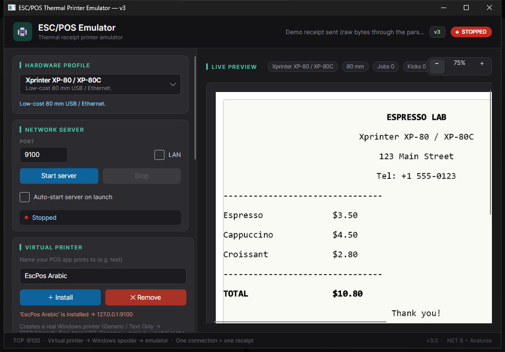

# ESC/POS Thermal Printer Emulator — v3

> Emulate an ESC/POS thermal receipt printer on Windows — live preview, 37 hardware
> profiles, virtual Windows printer, and full Arabic (RTL) support.

[](https://github.com/ZiadSafwat/EscPosEmulator/releases/latest)
[](https://dotnet.microsoft.com/download/dotnet/8.0)
[](https://avaloniaui.net/)
[](#build-from-source)
[](LICENSE)

<p align="center">
  
</p>

---

## ⬇️ Download

**Windows 10 / 11 · 64-bit · self-contained — no .NET installation required**

<p align="center">
  <a href="https://github.com/ZiadSafwat/EscPosEmulator/releases/latest/download/EscPosEmulator.exe">
    
  </a>
</p>

- **Direct download:** [EscPosEmulator.exe](https://github.com/ZiadSafwat/EscPosEmulator/releases/latest/download/EscPosEmulator.exe)
- **All versions & release notes:** [github.com/ZiadSafwat/EscPosEmulator/releases](https://github.com/ZiadSafwat/EscPosEmulator/releases)

The app is portable — put the `.exe` anywhere and run it. There is no installer and
no background service. Administrator rights (one UAC prompt) are needed only when
you **install** or **remove** the virtual Windows printer.

> **SmartScreen:** this is an unsigned hobby build. If Windows shows
> *"Windows protected your PC"*, click **More info → Run anyway**.

---

## Table of contents

- [What is it?](#what-is-it)
- [Feature highlights](#feature-highlights)
- [How it works](#how-it-works)
- [Quick start](#quick-start)
- [Connecting your POS app](#connecting-your-pos-app)
- [Arabic & RTL receipts](#arabic--rtl-receipts)
- [Printer preferences](#printer-preferences)
- [Raw ESC/POS test](#raw-escpos-test)
- [Build from source](#build-from-source)
- [Settings & data](#settings--data)
- [Troubleshooting](#troubleshooting)
- [Project layout](#project-layout)
- [Tech stack](#tech-stack)
- [Author & license](#author--license)

---

## What is it?

A Windows desktop app (.NET 8 + Avalonia) that behaves like a real ESC/POS thermal
receipt printer:

1. It starts a **RAW TCP print server** (default `127.0.0.1:9100`).
2. Optionally, it creates a **real, named Windows printer** (for example `test`)
   that forwards everything it receives to that TCP server.
3. Every byte stream is parsed as ESC/POS and rendered to a **live receipt
   preview** — while the POS app thinks it printed to real hardware.

It is built for POS development and QA: test receipt layouts, Arabic text,
barcodes, QR codes, raster logos, cuts and cash-drawer kicks without burning
paper or owning a thermal printer.

---

## Feature highlights

### Live preview & rendering

- **Accurate thermal look** — 576/512/384-dot paper widths, monospace and
  Arabic-capable fonts, cut marks, inverted text, underlines.
- **Live zoom** — 25 % to 300 %, with one-click reset to 100 %.
- **Raster image support** — `GS v 0` bands and `GS ( l 0x38`; consecutive
  driver bands are merged into one continuous bitmap.
- **Halftoning** for 1-bit raster graphics — none, ordered dots, or
  Floyd–Steinberg error diffusion.
- **Job + drawer counters** and an activity log for every connection.

### Virtual printer on Windows

- Creates a **real Windows printer** with any name you choose — visible in
  *Settings → Bluetooth & devices → Printers & scanners* and in every app's
  print dialog.
- Install, rename and remove from the UI. Rename = remove + install in a single
  elevated call.
- Only removes printers the app itself created.
- The app itself runs as a normal user (`asInvoker`); only the printer
  management step prompts for UAC.

### Hardware profiles

- **37 ESC/POS profiles** from Epson, Star, Citizen, Bixolon, Xprinter, Rongta,
  Gprinter, Zijiang, Sewoo, Honeywell, Zebra, POS-X, Ithaca and generic models.
- Each profile carries paper width, printable dots, DPI, cutter and drawer-kick
  capability, QR/raster support and default code page.
- Paper size presets for 58 mm / 76 mm / 80 mm rolls, plus a custom 72 mm size.

### Code pages & text

- CP437, CP850, CP852, CP858, CP860, CP863, CP865, CP866, Windows-1250/1251/
  1252/1253/1255/1256, CP720, Windows-874, Shift-JIS, GBK, Big5 and **UTF-8**
  (auto-detected).
- Switching code page via `ESC t n` is honoured per stream.
- Text formatting: bold, underline, double width/height, alignment, invert.
- QR codes (`GS ( k`), barcodes (`GS k` — CODE39, EAN13, EAN8, CODE128, UPCA,
  UPCE), raster graphics, cuts (`GS V`) and drawer kick detection (`ESC p`).

### Output & forwarding

- Forward the rendered receipt to **any real Windows printer** — thermal,
  laser or *Microsoft Print to PDF*.
- **Copies** (1–99) applied at print time.
- Windows-style **printer preferences** with page scale, line height, margins,
  borders, print order and halftoning.
- Layout, server port, profile, paper size and preferences are persisted; the
  server can auto-start on launch.

---

## How it works

```
POS app / .NET / Excel / WinSpool
        │  prints to "test" (real Windows printer)
        ▼
Windows spooler ── RAW TCP ──▶ 127.0.0.1:9100
                                     │
                              TcpPrinterServer
                                     │  parser.Feed(bytes)
                                     ▼
                              EscPosParser (thread-safe)
                                     │
                              ReceiptDocument
                                     │
                              Skia renderer ──▶ live preview
                                     │
                              (optional) forward to a system printer
```

- **One TCP connection = one print job.** Connect = fresh receipt; disconnect =
  job finished.
- By default the listener binds **loopback only** (`127.0.0.1`). Tick **LAN** and
  restart the server to bind `0.0.0.0`.
- The virtual printer uses the inbox **Generic / Text Only** driver and a
  Standard TCP/IP port named `EscPosEmu_127.0.0.1_<port>`.

---

## Quick start

1. **Download and run** [EscPosEmulator.exe](https://github.com/ZiadSafwat/EscPosEmulator/releases/latest/download/EscPosEmulator.exe).
2. Click **Start server** — the badge turns green (`LISTENING`).
3. Type a printer name (e.g. `test`) in **Virtual printer**, then click
   **＋ Install** and accept the UAC prompt.
4. In your POS app, print the receipt to that printer.
5. Watch it appear in the live preview.

No POS app handy? Click **☕ Send Demo Receipt** — it sends a complete ESC/POS
stream (init, alignment, bold, lines, QR, cut) to the built-in server.

---

## Connecting your POS app

There are three ways to feed the emulator:

| Method | When to use | Setup |
|---|---|---|
| **Virtual printer** | POS prints through the Windows print dialog / spooler | Install a printer name in the app, select it in the POS |
| **Raw TCP 9100** | POS supports ESC/POS network printers | Target `127.0.0.1:9100` (or the machine's LAN IP) |
| **Forward to a real printer** | You already have a printer queue and want to preview/duplicate | Pick the printer under *Forward to a real printer* → **Print Receipt** |

Notes:

- **One connection per receipt.** Network POS drivers usually open a fresh socket
  per job; that is exactly what the emulator expects.
- If port `9100` is already taken, change the port in **Network server** first —
  the virtual printer port follows the new port the next time you install it.
- For LAN access from another machine, enable **LAN**, restart the server, and
  allow the app through Windows Firewall when prompted.

---

## Arabic & RTL receipts

Arabic is the reason most emulators fail. This one implements the full pipeline:

- **Decoding** — Windows-1256 (`ESC t 27`), CP720 (`ESC t 30`) and UTF-8
  (auto-detected, even when a legacy table is selected).
- **Shaping** — HarfBuzz contextual shaping for connected Arabic letters.
- **Ordering** — a Unicode bidi pass keeps RTL runs right-to-left while embedded
  Latin words and numbers stay LTR.
- **Fonts** — Segoe UI / Tahoma / Noto Naskh Arabic are used instead of the Latin
  monospace font when Arabic is detected.
- **Line buffering** — text is decoded per line, so TCP chunk splits in the middle
  of a word or a multi-byte UTF-8 sequence never corrupt the output.
- **Raster fallback** — many Windows drivers rasterize the entire page into
  `GS v 0` bitmap bands. The emulator decodes and merges those bands, so the
  preview shows exactly what the driver produced.

Try it with **عربي Send Arabic Demo**.

> **Arabic shows as dots?**
> The Windows **Generic / Text Only** driver can drop non-CP437 characters before
> they reach the port. Point the POS at a printer queue that uses a real ESC/POS
> driver (for example an Xprinter XP-80C queue on the emulator's TCP port), or
> print through the raw TCP port directly.

---

## Printer preferences

**⚙ Printer Preferences…** opens a Windows-style dialog with three tabs:

| Tab | Settings |
|---|---|
| **Layout** | Print order (front-to-back / right-then-down), page scale 0.5–4.0, line height 0–99, paper borders, top/left margins |
| **Paper-Quality** | Copies per receipt (1–99), halftoning (none / ordered dots / smooth error diffusion) |
| **Advanced** | Live summary grid and **Properties…** (Advanced Document Settings) |

- **OK** applies the settings, saves them and closes.
- **Apply** applies and persists immediately without closing.
- **Cancel** / **X** / `Esc` discards the draft — the preview stays untouched.
- **Restore Defaults** resets the dialog to built-in values (still requires
  OK/Apply).

Settings are saved to `%LOCALAPPDATA%\EscPosEmulator\settings.json` and restored
on the next launch.

---

## Raw ESC/POS test

Send a receipt directly over TCP (no virtual printer needed):

```powershell
$client = [System.Net.Sockets.TcpClient]::new("127.0.0.1", 9100)
$stream = $client.GetStream()

$init  = [byte[]](0x1B, 0x40)                       # ESC @ — initialize
$text  = [System.Text.Encoding]::UTF8.GetBytes("Hello from raw ESC/POS!`n")
$cut   = [byte[]](0x1D, 0x56, 0x00)                 # GS V 0 — full cut

$bytes = $init + $text + $cut
$stream.Write($bytes, 0, $bytes.Length)
$stream.Flush()
$client.Close()
```

The preview should show the line with a cut mark and the job counter should
increase by one.

---

## Build from source

**Requirements**

- Windows 10 / 11 (the app also builds on Linux/macOS, but virtual-printer and
  system-printer features are Windows-only).
- [.NET 8 SDK](https://dotnet.microsoft.com/download/dotnet/8.0)
- Visual Studio 2022, Rider or VS Code (optional).

```powershell
git clone https://github.com/ZiadSafwat/EscPosEmulator.git
cd EscPosEmulator

dotnet build EscPosEmulator.sln
dotnet run --project src\EscPosEmulator
```

**Create the single-file release exe:**

```powershell
dotnet publish src\EscPosEmulator\EscPosEmulator.csproj `
  -c Release -r win-x64 --self-contained true `
  -p:PublishSingleFile=true `
  -p:IncludeNativeLibrariesForSelfExtract=true `
  -p:DebugType=None -p:DebugSymbols=false `
  -o publish\win-x64
```

The result is `publish\win-x64\EscPosEmulator.exe` — self-contained, no .NET
runtime required on the target machine.

---

## Settings & data

| Path | Contents |
|---|---|
| `%LOCALAPPDATA%\EscPosEmulator\settings.json` | Port, LAN mode, auto-start, profile, paper size, code page, virtual printer name, printer settings |

There is no database and no telemetry. Delete the file to return to defaults.

---

## Troubleshooting

| Symptom | Cause / fix |
|---|---|
| Badge stays **STOPPED** | Click **Start server**; check that the port is free |
| POS prints but preview is empty | POS is printing to a different queue/port — select the virtual printer created by this app, or point it at `127.0.0.1:<port>` |
| `Address already in use` | Another app owns port 9100 — change the port and restart, then reinstall the virtual printer |
| Arabic appears as dots | Generic / Text Only stripped the characters — use a real ESC/POS driver queue or raw TCP (see [Arabic](#arabic--rtl-receipts)) |
| Virtual printer **Remove** is disabled | The app only removes printers it created; remove other queues from Windows Settings |
| UAC prompt appears | Expected for install/remove/rename only; the app runs as a normal user |
| SmartScreen blocks the exe | **More info → Run anyway** (unsigned community build) |
| Preview is clipped / too small | Use the **− / 100 % / +** zoom cluster (25 %–300 %) |
| Nothing happens after **Print Receipt** | Pick a system printer in the dropdown; install one if the list is empty |

---

## Project layout

```
src/EscPosEmulator/
  Program.cs, App.axaml(.cs), app.manifest      bootstrap, asInvoker manifest
  Core/EncodingHelper.cs                        code-page encodings
  Models/
    PaperSize.cs, PrinterProfile.cs             37 profiles + paper presets
    RenderOptions.cs                            printer preferences model
    ReceiptDocument.cs, ReceiptElement.cs       parsed receipt tree
    PrinterState.cs                             parser state
  Parsing/EscPosParser.cs (+ .Commands.cs)      thread-safe ESC/POS parser
  Rendering/ReceiptRenderer.cs                  Skia 2-pass renderer + dithering
  Services/
    TcpPrinterServer.cs                          RAW TCP server (1 conn = 1 job)
    VirtualPrinterService.cs                     install/rename/remove (UAC)
    PrintService.cs                              forward receipt to a real printer
    AppSettings.cs                               %LOCALAPPDATA% settings.json
  ViewModels/
    MainViewModel.cs                             MVVM orchestration
    PrintingPreferencesViewModel.cs              preferences + advanced dialog
  Views/
    MainWindow.axaml(.cs)                        main UI
    PrintingPreferencesWindow.axaml(.cs)         Windows-style preferences
    AdvancedDocumentSettingsWindow.axaml(.cs)    properties grid
docs/main-window.png                             screenshot used in this README
```

---

## Tech stack

- [.NET 8](https://dotnet.microsoft.com/) + [Avalonia UI 11](https://avaloniaui.net/) — cross-platform desktop UI
- [CommunityToolkit.Mvvm](https://learn.microsoft.com/dotnet/communitytoolkit/mvvm/) — MVVM source generators
- [SkiaSharp](https://github.com/mono/SkiaSharp) + HarfBuzz — rendering and Arabic shaping
- [QRCoder](https://github.com/codebude/QRCoder) and [ZXing.Net](https://github.com/micjahn/ZXing.Net) — QR/barcode rendering
- Windows spooler + `printui` / `rundll32` — virtual printer provisioning

---

## Author & license

**Ziad El-Araby** — Full-Stack .NET Developer | Flutter & Angular Enthusiast

- 📧 [Ziadsafwataraby@gmail.com](mailto:Ziadsafwataraby@gmail.com)
- 🔗 [Portfolio](https://ziadsafwat.github.io/Ziad-Safwat-Portfolio/)
- 🔗 [GitHub @ZiadSafwat](https://github.com/ZiadSafwat)

Licensed under the [MIT License](LICENSE).

If this project saves you a roll of thermal paper, consider giving it a ⭐ on
GitHub — or [buy me a coffee](https://bmc.link/ziadsafwat1).
